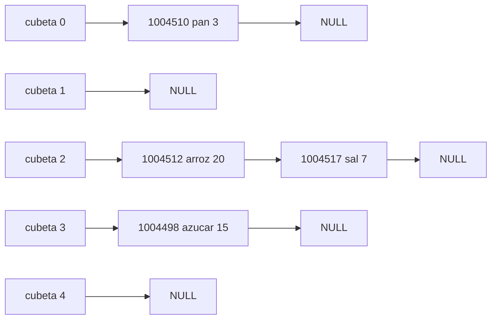
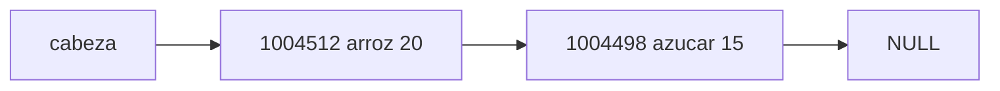
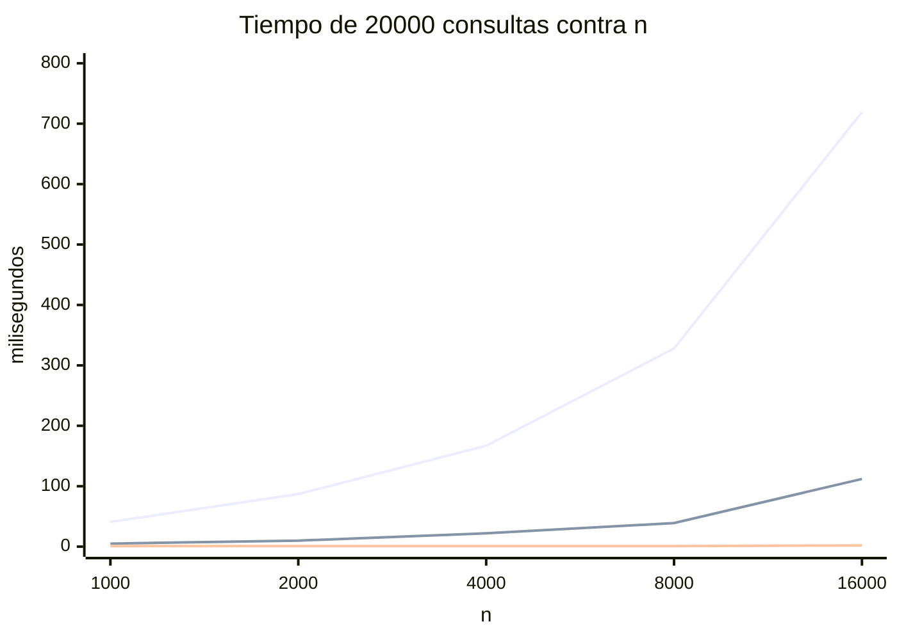

# Informe final

## 1. El escenario y el modelado

Es el inventario de una tienda el cual guarda cada articulo con su respectivo código numerico, nombre y cantidad. El codigo no se puede repetir por que identifica a un producto. Lo usaria el encargado de la tienda para llevar el control de existencias, dar de alta y de baja articulos, consultar cuanto hay de cantidad, reponer cantidad y listar todo. Le resuelve tener el inventario en un solo sitio, y sin duplicados y con respuestas rapidas sin importa que tanto crezca.

Un articulo guarda codigo (`long long`), nombre (una palabra maximo 63 caracteres) y cantidad (`int`).

| Operación | Qué hace | Precondición |
| --- | --- | --- |
| `AGREGAR c nombre cantidad` | inserta un artículo nuevo | el código c no está en el inventario |
| `ELIMINAR c` | quita el artículo y libera su nodo | c está en el inventario |
| `CONSULTAR c` | escribe código, nombre y cantidad | c está en el inventario |
| `REPONER c cantidad` | suma cantidad al artículo | c está en el inventario |
| `LISTAR` | escribe todos los artículos, uno por línea | ninguna |

**Por qué lista enlazada simple.** Frente a un arreglo, los artículos entran y salen en cualquier momento y en cualquier posición, porque se eliminan por código. Con un arreglo, eliminar uno del medio obliga a desplazar todos los que están después, y si se llena hay que pedir un arreglo más grande y copiar todo. En la lista, una vez encontrado el nodo, eliminarlo es reenlazar dos punteros y liberarlo, y no hay capacidad máxima que fijar al crearla. Contra una lista ordenada, mantener el orden por código costaría insertar en su lugar, y ninguna operación del escenario necesita los artículos ordenados. Una lista doble llevaría un puntero más por nodo solo para poder ir hacia atrás, y eso no se necesita. Lo que se pierde es el acceso directo por código: casi todo es O(n), y eso es justo lo que ataca la tabla hash. Los costos de buscar, insertar y eliminar en una lista simple, y su comparación con el arreglo, se estudian en R. Thareja, *Data Structures Using C* (2018), capítulo 6, sección 6.2.

**Por qué tabla con encadenamiento.** La tabla reparte los n artículos en m cubetas según `codigo mod m` (corregido si es negativo). Cada cubeta es exactamente la lista simple de arriba, así que se reutiliza `lista.c` sin cambios, y solo hay que recorrer la cadena de una cubeta en vez de toda la lista: en promedio α = n/m nodos en vez de n. No hay que mover artículos de lugar ni calcular sondeos, y eliminar sigue siendo reenlazar dos punteros. El encadenamiento como método de resolución de colisiones se describe en Thareja (2018), capítulo 15 (hashing y colisiones), sección de resolución de colisiones por encadenamiento.


**Invariantes:**

- I₁: ∀ i,j ∈ \[0,n), i ≠ j ⇒ cᵢ ≠ cⱼ (no hay códigos repetidos).
- I₂ (lista): p₀ = cabeza ∧ ∀ i ∈ \[0,n−1): pᵢ.sig = pᵢ₊₁ ∧ pₙ₋₁.sig = NULL. Con la lista vacía (n = 0) se cumple cabeza = NULL.
- I₃ (tabla): ∀ k ∈ \[0,m), ∀ nodo x de la cubeta k: x.codigo mod m = k (con el residuo corregido para quedar en \[0,m)). Además, cada cubeta cumple I₂ por separado e I₁ vale en toda la tabla. Por I₃, buscar un código solo exige mirar la cubeta `codigo mod m`.


## 2. Las dos estructuras

| Archivo | Contenido |
| --- | --- |
| `inventario.h` | Interfaz `inv_*`, tipo opaco `Inventario`, `inv_crear(int m)`. |
| `lista.h`, `lista.c` | Solo la lista de nodos: `lista_buscar`, `lista_agregar`, `lista_eliminar`, `lista_imprimir`, `lista_destruir`. |
| `inventario_lista.c` | `inv_*` sobre una sola lista. Ignora `m`. |
| `tabla.c` | `inv_*` sobre un arreglo de `m` listas. Cubeta = `codigo mod m`, corregido si es negativo. |
| `principal.c` | Lee las órdenes e imprime. Es el mismo para las dos estructuras. |
| `medir.c`, `medir_map.cpp` | Misma carga de trabajo para lista, tabla y `std::map`. |

`medir_map.cpp` es un archivo aparte porque `std::map` no existe en C; por eso se compila con g++. Reproduce a mano la misma carga de medir.c para que los tiempos sean comparables.

Diagrama de la tabla con m = 5, tras agregar `1004510 pan 3`, `1004512 arroz 20`, `1004517 sal 7` y `1004498 azucar 15`. Los códigos 1004512 y 1004517 caen ambos en la cubeta 2 (residuo 2), por eso forman una cadena:




Diagrama de la lista simple con los mismos artículos de la tienda:



## 3. Análisis formal de complejidad

Sea n el numero de articulos. Cada visita a un nodo en `lista_buscar` (comparar el codigo y avanzar el puntero) cuenta un tiempo constante c₁. Las operacion de una sola vez como crear un nodo con `malloc` y copiar =< 63 caracteres, reelazar, liberar, copiar nombre y cantidad cuestan una constante c₂.

**Teorema.** `CONSULTAR` en la lista cuesta O(n) en tiempo y O(1) de espacio extra.

**Demostración.** Se procede de forma directa. Se cuenta cuantas veces se ejecuta el ciclo de `lista_buscar` en el peor caso y se le suma lo que `inv_consultar` hace fuera del ciclo. El peor caso es que el codigo este en el ultimo nodo o que no este: en se visitan los n nodos.

*Desarrollo.* `lista_buscar` avanza mientras `p != NULL` y el codigo de p sea distinto del buscado. Cada iteracion avanza un nodo y la lista tien n nodos(por I₂ terminba en NULL), asi que hay a lo sumo n iteraciones, cada una de costo c₁. despues `inv_consultar`hace un `strncpy` de si mucho 63 caracteres y una asignacion de costo c₂.

T(n) ≤ c₁·n + c₂ ≤ (c₁ + c₂)·n para todo n ≥ 1

El espacio extra son los punteros locales `p` y `n` y el buffer fijo de 64 bytes del nombre, que no dependen de n.

*Conclusión.* Por lo tanto, T(n) ∈ O(n) con testigos c = c₁ + c₂ y k = 1, y el espacio extra es O(1). ∎

**Las demás operaciones en la lista.**

- `REPONER`: `inv_reponer` llama a `lista_buscar` (la misma cuenta del teorema, paso *Desarrollo*) y luego suma a un campo: T(n) ≤ c₁·n + c₂, así que es O(n) y O(1) de espacio.
- `AGREGAR`: `lista_agregar` recorre con el mismo ciclo de `lista_buscar` hasta encontrar el código repetido o llegar al final (a lo sumo n visitas, para verificar I₁ y llegar al último nodo), y después hace `malloc`, copia y enlaza: T(n) ≤ c₁·n + c₂. Es O(n), O(1) de espacio extra (el nodo nuevo es parte de la estructura, no espacio auxiliar). Reutiliza el paso *Desarrollo* del teorema.
- `ELIMINAR`: recorre hasta el nodo (a lo sumo n visitas), reenlaza el anterior con el siguiente y hace `free`: T(n) ≤ c₁·n + c₂. Es O(n) y O(1) de espacio. Si el nodo es la cabeza el costo es constante, pero el peor caso (último nodo o no existe) visita n.
- `LISTAR`: visita cada nodo exactamente una vez y en cada uno hace un `fprintf` de costo acotado: T(n) = c₁·n + c₂, es decir Θ(n), O(1) de espacio.


**Las cinco operaciones en la tabla.** Sea m el número de cubetas y α = n/m el factor de carga es decir el largo promedio de una cadena. Aparece porque la tabla solo recorre la cadena de una cubeta, no toda la lista. `indice` cuesta c₃ constante (un módulo). Si L es el largo de la cadena de la cubeta, `CONSULTAR`, `REPONER`, `AGREGAR` y `ELIMINAR` cuestan a lo sumo c₃ + c₁·L + c₂, por la misma cuenta de la lista aplicada a una sola cadena (por I₃ el código solo puede estar en esa cubeta). Con el supuesto de dispersión uniforme (cada código cae en cada cubeta con probabilidad 1/m), el largo esperado de una cadena es α, así que el costo esperado es O(1 + α). En el peor caso todos los códigos caen en una sola cubeta, L = n, y el costo es O(n): es lo que pasa en el modo 1 del experimento. `LISTAR` recorre las m cubetas (aunque estén vacías) y los n nodos: Θ(n + m). El espacio extra por operación es O(1); la tabla en sí ocupa O(m) punteros más O(n) nodos.

Resumen de costos:

| Operación | Lista | Tabla | `std::map` | Por qué |
| --- | --- | --- | --- | --- |
| `AGREGAR` | O(n) | O(1 + α) esperado, O(n) peor | O(log n) | la lista y la tabla buscan repetidos antes de insertar; el mapa baja por un árbol balanceado |
| `CONSULTAR` | O(n) | O(1 + α) esperado, O(n) peor | O(log n) | la lista recorre todo; la tabla solo una cadena; el mapa un camino de altura log n |
| `REPONER` | O(n) | O(1 + α) esperado, O(n) peor | O(log n) | es una búsqueda más una suma |
| `ELIMINAR` | O(n) | O(1 + α) esperado, O(n) peor | O(log n) | es una búsqueda más reenlazar |
| `LISTAR` | O(n) | O(n + m) | O(n) | visita todos los nodos; la tabla además recorre las m cubetas |

## 4. Experimentos

**Máquina y compilador.** Procesador: 11th Gen Intel(R) Core(TM) i5-11400H @ 2.70 GHz. Memoria: 16 GB de RAM. Sistema operativo: Windows 11. `gcc --version`: 16.2.0. `g++ --version`: 16.2.0 . Banderas: `-Wall -Wextra -O2`.

**Como se midio.** `medir n m q modo`  inserta n articulos, hace que q = 20000 consultas siendo la mitad codigos existentes y la mitad inexistentes; y elimina los n. en el modo 0, el código del artículo i es ((i · 2654435761) mod 1000000007) + 1, que parece aleatorio y reparte los códigos casi uniformemente entre las cubetas. En el modo 1 es (i + 1) · m, así que todos los códigos son múltiplos de m y caen en la cubeta 0: la tabla degenera en una sola lista. Las consultas pares piden el código del artículo (j/2) mod n, que existe; las impares piden el del índice n + (j/2) mod n, que nunca se insertó. Tiempo con `clock()`. Se tomó la mediana de 3 ejecuciones. Los valores 0 son menos de 1 ms, la resolución del reloj. El script está en el apéndice y los datos crudos en `datos/resultados.txt`.

La fila «tabla, 1 cubeta» se corrio con `.\medir_tabla n 1009 q 1`: la tabla tiene 1009 cubetas pero con el modo 1 todos los codigos son multiplos de 1009, asi que todos caen la cubeta 0 comportandose como una lista de una sola cubeta.

**Consultar (ms):**

| n | lista | tabla m=11 | tabla m=n | tabla m=100003 | tabla, 1 cubeta | `std::map` |
| --- | --- | --- | --- | --- | --- | --- |
| 1000 | 41 | 5 | <1 | <1 | 44 | 1 |
| 2000 | 87 | 10 | <1 | <1 | 84 | 1 |
| 4000 | 167 | 22 | <1 | <1 | 167 | 1 |
| 8000 | 328 | 39 | 1 | <1 | 329 | 1 |
| 16000 | 719 | 112 | <1 | <1 | 707 | 2 |

**Insertar (ms):**

| n | lista | tabla m=11 | tabla m=n | tabla m=100003 | tabla, 1 cubeta | `std::map` |
| --- | --- | --- | --- | --- | --- | --- |
| 1000 | 1 | <1 | <1 | <1 | 1 | <1 |
| 2000 | 6 | 1 | <1 | <1 | 6 | <1 |
| 4000 | 25 | 2 | <1 | 1 | 23 | <1 |
| 8000 | 92 | 12 | <1 | 1 | 96 | 1 |
| 16000 | 377 | 57 | 1 | 1 | 380 | 1 |

**Eliminar (ms):**

| n | lista | tabla m=11 | tabla m=n | tabla m=100003 | tabla, 1 cubeta | `std::map` |
| --- | --- | --- | --- | --- | --- | --- |
| 1000 | <1 | <1 | <1 | <1 | <1 | <1 |
| 2000 | <1 | <1 | <1 | <1 | <1 | <1 |
| 4000 | <1 | <1 | <1 | <1 | <1 | 1 |
| 8000 | <1 | <1 | <1 | <1 | <1 | <1 |
| 16000 | <1 | 1 | 1 | 1 | 1 | 1 |


Todos dan menos de 1 ms, salvo 1 ms con n = 16000 (y un 1 suelto de `std::map` con n = 4000, que es ruido del reloj). La lista no muestra aquí su peor caso porque se elimina en el mismo orden en que se insertó: como `lista_agregar` inserta al final, el artículo que se elimina es siempre la cabeza, y quitar la cabeza cuesta O(1). Las n eliminaciones cuestan entonces O(n) en total y no O(n²). El peor caso sería eliminar en orden inverso, y entonces cada eliminación recorrería toda la lista. Lo mismo pasa dentro de cada cubeta de la tabla.



Curvas de arriba abajo: lista crece en linea recta con n, tabla con m = 11 es tambien lineal pero con pediente mucho menor y `std::map` es casi plana. La tabla m = n y m = 100003 quedan pegadas al eje en 0 y no se dibujan.

## 5. Lo medido contra lo predicho

1. **Lista, `CONSULTAR`.** Al duplicar n el tiempo se multiplica por 2.1, 1.9, 2.0 y 2.2, en promedio unas 2.05 veces. Coincide con Θ(n), donde se predijo T(2n) ≈ 2·T(n). Como comprobación, con n = 16000 se visitan en promedio 0.75·n nodos por consulta (la mitad de las consultas encuentra el código hacia la mitad, la otra mitad recorre todo), o sea 20000 · 12000 = 240 millones de visitas; 719 ms entre 240 millones da unos 3 ns por nodo, un costo razonable por visita. Insertar se multiplica por cerca de 4 (6, 4.2, 3.7 y 4.1) porque son n inserciones y cada una recorre primero toda la lista para buscar repetidos: 0 + 1 + … + (n−1) = n(n−1)/2 visitas, que es Θ(n²). Al duplicar n, n² se multiplica por 4. El primer salto (1 a 6 ms) está inflado porque 1 ms es la resolución del reloj. También da unos 3 ns por visita (128 millones de visitas en 377 ms).
2.**Tabla con m = 11** Cada cadena tiene en promedio n/11 nodos, asi que se predice recorrer 11 veces menos que en la lista. se midio entre 6.4 y 8.7 veces mas rapido(8.2, 8.7, 7.6, 8.4 y 6.4), algo menos de los predicho. La explicacion es que hay un costo fijo por consulta que no se reduce, calcular indice, la llamada a funcion, el `strncpy` y el ciclo de medicion; y que con tiempos de 5 a 10 ms el error de mas o menos 1 ms del reloj pesa. Sigue creciendo con n porque m esta fijo en 11: α = n/11 crece con n, y el costo sigue siendo Θ(n), solo que con constante 1/11.
3. **Tabla con m = n y con m = 100003.** Con m = n, α = 1; con m = 100003, α = n/100003 ≤ 0.16 para todos los n medidos. En ambos casos las cadenas tienen cero o un par de nodos, así que cada consulta hace una o dos visitas: 20000 consultas son unas decenas de miles de operaciones de nanosegundos, decenas de microsegundos en total, muy por debajo de 1 ms. Por eso no se distinguen de cero con ese reloj.
4.**Tabla con 1 cubeta.** Casi igual a la lista (707 constra 719 ms con n = 16000). Se predijo que se comportaria como la lista, porque todos los codigos caen en la misma cubeta y por  I₃ esa cubeta es una lista simple con los n nodos; lo unico extra es calcular indice, que es una operacion constante despreciable. Es el caso malo de la tabla α = n/m no es la medida correcta cuando los códigos no se reparten, y el costo cae a O(n).
5. **`std::map`.** Casi no crece (de 1 a 2 ms) porque su costo es O(log n): con n = 16000 una búsqueda baja por unos 14 niveles (log₂ 16000 ≈ 14) en vez de recorrer miles de nodos, y duplicar n suma un solo nivel. Una tabla le gana cuando α se mantiene acotada (m ≈ n o mayor): costo esperado O(1) contra O(log n), y en las mediciones m = n queda por debajo de 1 ms mientras el mapa marca 1 o 2 ms (aunque la resolución del reloj no permite afirmar cuánto más rápida es). No le gana cuando la función hash reparte mal (como el modo 1), cuando m es chica comparada con n (α grande), o cuando se necesita recorrer los artículos ordenados por código, que el mapa da gratis. Además el mapa garantiza O(log n) en el peor caso, y la tabla no.
6. **¿Alguna medición no coincide?** Casi todas coinciden dentro de la resolución. Lo que más se aleja es la tabla con m = 11 al pasar de n = 8000 a n = 16000 se multiplica por 2.9 y no por 2 (el resto de pasos fue 2.0, 2.2 y 1.8). Una posibilidad es el caché: cada nodo ocupa unos 88 bytes (8 + 64 + 4 + 4 de relleno + 8), así que 16000 nodos ocupan cerca de 1.4 MB y el conjunto de trabajo ya no cabe tan cómodamente en los niveles de caché más cercanos; no lo comprobé con un perfilador. También hay valores sueltos de 1 ms (por ejemplo insertar con m = 100003 y n = 4000 marca 1 ms y m = n marca 0) que son ruido de la resolución del reloj. Hay que tener en cuenta que todo se midió en una sola máquina, con Windows y otros procesos corriendo, y con la mediana de solo 3 ejecuciones.


**Orden de `LISTAR`.** En la lista sale por orden de llegada, porque `lista_agregar` inserta al final. En la tabla sale cubeta por cubeta, así que depende de `codigo mod m` y cambia con m. Para igualar el orden habría que ordenar la salida de las dos por código antes de escribirla (a costo extra de O(n log n)). Los casos de prueba que se usaron no dependen de esto: el único que usa `LISTAR` con artículos (caso 5) lista un solo artículo cada vez.

**Pruebas.** Cada caso se corrió con las dos estructuras (`inventario_lista` e `inventario_tabla`) y la salida coincide con la esperada, comparada con `diff` en `make pruebas`.

| Caso | Entrada | Salida esperada | Salida obtenida |
| --- | --- | --- | --- |
| caso 1 (funcional) | ejemplo del enunciado: 7 órdenes con arroz y azúcar (agregar, consultar, reponer, eliminar) | `ok`, `ok`, `1004512 arroz 20`, `ok`, `1004498 azucar 15`, `ok`, `no existe` | igual a la esperada |
| caso 2 (funcional) | `AGREGAR 1 sal 5`, `AGREGAR 1 pan 3`, `CONSULTAR 1` | `ok`, `repetido`, `1 sal 5` | igual a la esperada |
| caso 3 (funcional) | `REPONER 9 4`, `ELIMINAR 9`, `CONSULTAR 9` | `no existe`, `no existe`, `no existe` | igual a la esperada |
| caso 4 (límite) | `LISTAR` con el inventario vacío | no escribe nada | no escribió nada |
| caso 5 (límite) | agrega 4 artículos, elimina la cabeza, uno del medio y el último, lista, elimina el que queda, lista (vacío), consulta y agrega otro | `ok` ×4, `ok` ×3, `2 b 2`, `ok`, `no existe`, `ok` | igual a la esperada |

El inventario vacio es el caso limite porque es el estaod inicial y el que mas facil rompe la implementacion `LISTAR`, que debe recorrer cero nodos sin fallar y sin escribir nada. El caso 5 cubre el otro limite, eliminar hasta dejar la estructura vacia y volver a usarla, y comprueba que quitar el primero, uno intermedio y el ultmo deja los enlaces bien.


## 6. Conclusiones


Para el inventario de una tiendo con unos cientos de articulos la lista simple basta, pues es la mas sencilla y con n pequeño, los 3 n por nodo no se notan. cuando el catalogo llega a miles de articulos conviene la tabla con encadenamiento y un m del orden de n o mayor(α ≤ 1), porque las consultas pasan de cientos de milisegundos a menos de 1 ms en las mediciones y reutiliza la misma lista sin cambiar la interfaz. La respuesta cambiaria si los codigos no se reparten bien como el modo 1 donde la se vuelve tan lenta como la lista, si no se conoce n de antemano y m queda muy pequeño, o si se necesita lista o recorrer los articulos ordenados por codigo, caso en el que `std::map`  es mejor. Una mejor natural seria redimensionar la tabla cuando α supere un limite.

**Referencias.**

- R. Thareja, *Data Structures Using C*, 2018: capítulo 6, sección 6.2 (listas enlazadas simples); capítulo 15 (hashing y resolución de colisiones por encadenamiento).
- Herramientas de IA: Claude (Anthropic), usado para ayudar a redactar y revisar este informe a partir del código y las mediciones del proyecto.


## Apéndice: script de medición

```bash
#!/bin/bash
mediana() {
    for r in 1 2 3; do "$@"; done > /tmp/m.txt
    for c in 1 2 3; do
    awk -v c=$c '{print $c}' /tmp/m.txt | sort -n | sed -n 2p
    done | tr '\n' ' '
    echo
}
q=20000
for n in 1000 2000 4000 8000 16000; do
    echo "== n=$n  (columnas: insertar consultar eliminar)"
    echo -n "lista            "; mediana ./medir_lista $n 1 $q 0
    echo -n "tabla m=11       "; mediana ./medir_tabla $n 11 $q 0
    echo -n "tabla m=$n    "; mediana ./medir_tabla $n $n $q 0
    echo -n "tabla m=100003   "; mediana ./medir_tabla $n 100003 $q 0
    echo -n "tabla 1 cubeta   "; mediana ./medir_tabla $n 1009 $q 1
    echo -n "map              "; mediana ./medir_map $n 1 $q 0
done
```
